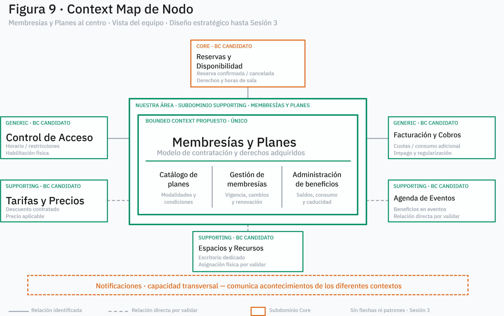

# Nodo — Membresías y Planes

Repositorio académico del análisis estratégico del área de Membresías y Planes de Nodo, una empresa de coworking y espacios compartidos.

## Alcance y decisión de diseño

El trabajo corresponde al diseño estratégico hasta la Sesión 3. Membresías y Planes se clasifica como **Supporting**; **Reservas y Disponibilidad** es el **Core Domain** identificado en el caso. Se conserva **un único Bounded Context propio**, `Membresías y Planes`, con tres capacidades internas: **Catálogo de Planes**, **Gestión de Membresías** y **Administración de Beneficios**. Los seis contextos vecinos son candidatos de delimitación que los equipos responsables deben validar. Notificaciones es una capacidad transversal, no un BC necesariamente propio.

**Estado: «Diseño estratégico hasta Sesión 3; integración y táctico pendientes».** No hay código de aplicación, selección de tecnología ni patrones de integración. Los acuerdos de integración se dejan para la Sesión 4 y el modelo táctico para las Sesiones 5–6.

## Navegación

| Artefacto | Contenido |
|---|---|
| [Mapa de subdominios](docs/01-subdominios.md) | Ocho capacidades, clasificación estratégica y casos límite |
| [Glosario](docs/02-glosario.md) | Lenguaje por capacidad, distinciones y polisemias |
| [EventStorming](docs/03-eventstorming.md) | Tres procesos, comandos, eventos, políticas y hotspots |
| [Domain Stories](docs/04-domain-stories.md) | DS-01–DS-03 as-is/to-be, fricciones y escenarios alternativos |
| [Context Map](docs/05-context-map.md) | Vecinos candidatos, relaciones e intercambios conceptuales |
| [Reglas e invariantes](docs/06-reglas-invariantes.md) | RN-01–RN-15, INV-01–INV-07 y POL-01–POL-09 |
| [Bounded Context](docs/07-bounded-context.md) | Señales, alternativas y justificación del único BC |
| [Hotspots y riesgos](docs/08-hotspots-riesgos.md) | H-01–H-12, R-01–R-10 y preguntas para Sesión 4 |
| [Trazabilidad](docs/09-trazabilidad.md) | Reglas y decisiones enlazadas con fuente, escenarios y límites |
| [Esqueleto conceptual](src/membresias-y-planes/README.md) | Frontera y vocabulario, sin implementación |
| Decisión de un BC | [ADR 0001](decisiones/0001-delimitacion-unico-bounded-context.md) |
| Core frente a Supporting | [ADR 0002](decisiones/0002-core-vs-supporting.md) |
| Fronteras externas | [ADR 0003](decisiones/0003-fronteras-y-relaciones-externas.md) |
| Hotspots pendientes | [ADR 0004](decisiones/0004-hotspots-y-decisiones-pendientes.md) |

### Figura 9 — Context Map

Las líneas representan relaciones sin dirección ni patrón de integración; las relaciones directas pendientes de validación se distinguen de las identificadas. La lectura y sus límites están en [05-context-map.md](docs/05-context-map.md).

## DD y hotspots prioritarios

- **DD-01–DD-10** conservan la clasificación Supporting, un BC con tres capacidades, la separación de responsabilidades y el aplazamiento de decisiones técnicas. **DD-02 y DD-03** son hipótesis principales de delimitación.
- Prioridad alta documentada: **H-01, H-03, H-04, H-05, H-08, H-09, H-10 y H-12**. Entre las preguntas centrales están la activación y el impago, la persistencia de condiciones contratadas, y el consumo, restitución y concurrencia de horas. Ver [08-hotspots-riesgos.md](docs/08-hotspots-riesgos.md).
- Integrantes y roles: **Pendiente de completar por el equipo**; no constan en la evidencia disponible en este workspace.

## Evidencia y cautelas

Los documentos originales utilizados durante el análisis no se incluyen en este repositorio. La trazabilidad conserva referencias internas a secciones y páginas, distingue los hechos resumidos de las hipótesis y señala dónde no es posible comprobar la procedencia primaria. Las nueve figuras PNG disponibles se conservan sin recrear diagramas.
