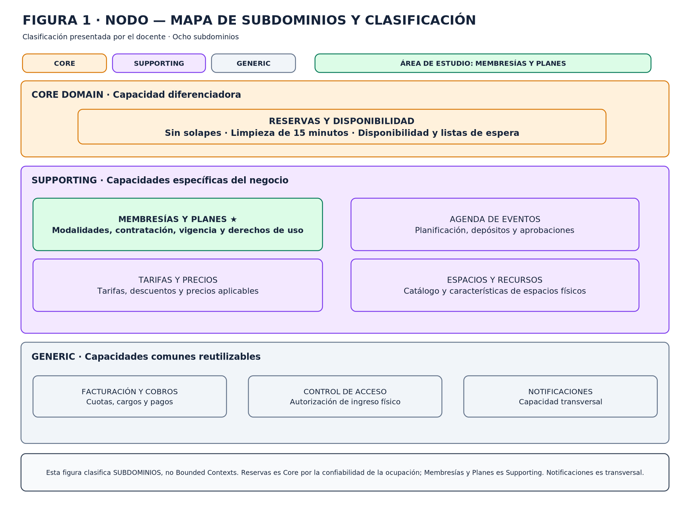

# 01 · Subdominios y clasificación

La clasificación refleja el escenario de Nodo descrito en el análisis estratégico, no una decisión tecnológica ni una afirmación de que cada subdominio equivalga a un Bounded Context.

## Ocho capacidades de negocio

| Subdominio | Clasificación | Responsabilidad y fundamento estratégico |
|---|---|---|
| Reservas y Disponibilidad | **Core** | Asigna recursos compartidos, evita solapamientos, respeta 15 minutos de limpieza entre usos de una sala y gestiona listas de espera. Una reserva confirmada que no pueda atenderse afecta directamente la confianza y la prestación del servicio. |
| Membresías y Planes | **Supporting** | Define las modalidades, administra su ciclo de vida y determina derechos de uso. Es fundamental para operar, pero las fuentes sitúan la ventaja competitiva principal en la confiabilidad de las reservas, no en las membresías. |
| Agenda de Eventos | **Supporting** | Gestiona contratación, programación, condiciones particulares, anticipos y aprobaciones de eventos. |
| Tarifas y Precios | **Supporting** | Determina importes por recurso, horario y condiciones comerciales, incluidos descuentos aplicables. |
| Espacios y Recursos | **Supporting** | Mantiene identidad, características y condiciones de uso de los recursos físicos. |
| Facturación y Cobros | **Generic** | Gestiona facturas, cargos, pagos y obligaciones económicas; el documento recomienda evaluar servicios especializados. |
| Control de Acceso | **Generic** | Gestiona credenciales y mecanismos habituales de ingreso; el documento propone evaluar soluciones existentes. |
| Notificaciones | **Generic, transversal** | Comunica acontecimientos de múltiples procesos. Es una capacidad transversal y no implica por sí misma un BC autónomo. |

## Ventaja competitiva y decisión de construir o integrar

El caso identifica la asignación confiable de espacios compartidos como diferenciador de Nodo: prevenir conflictos, respetar la preparación de salas y responder a demanda superior a la disponibilidad. La experiencia del cliente se resiente si se confirma una reserva que Nodo no puede atender. Por esto Reservas y Disponibilidad se toma como Core; no basta con ofrecer una agenda, se debe sostener la consistencia bajo las restricciones operativas específicas.

Membresías y Planes define compromisos y derechos relevantes, pero el análisis no establece que las modalidades sean el motivo principal por el que se elige Nodo. Esa valoración podría cambiar si la estrategia futura se centrase en beneficios altamente personalizables o modalidades difíciles de replicar; no es la situación respaldada ahora.

| Área | Orientación estratégica de la fuente, no vinculante |
|---|---|
| Reservas y Disponibilidad | Priorizar un modelo propio para aplicar restricciones de Nodo y consistencia de asignación. |
| Membresías y Planes | Mantener control sobre reglas de contratación, ciclo de vida y beneficios; evaluar reutilización de componentes comunes. |
| Agenda de Eventos | Conservar reglas particulares de aprobación y contratación; reutilizar capacidades comunes donde convenga. |
| Tarifas y Precios | Mantener las reglas comerciales propias y evaluar componentes reutilizables para determinar importes. |
| Espacios y Recursos | Evaluar soluciones existentes, conservando los datos específicos que necesita el negocio. |
| Facturación y Cobros | Evaluar servicios especializados de facturación, cobro y procesamiento. |
| Control de Acceso | Evaluar integración con soluciones existentes de identificación e ingreso físico. |
| Notificaciones | Apoyarse preferentemente en capacidades de comunicación existentes. |

No se elige proveedor, plataforma, lenguaje ni arquitectura. “Construir o integrar” es una orientación estratégica revisable, no autorización para implementar ahora.

## Caso límite: Reservas frente a Membresías

Una membresía puede conceder horas de sala, pero no crea disponibilidad física: Membresías y Planes decide qué derecho y saldo corresponden; Reservas y Disponibilidad decide franjas, ocupación, confirmación y conflictos. La confirmación no demuestra por sí sola que las horas se hayan consumido. El momento de descuento y la restitución continúan pendientes (**H-04, H-05**). La frontera conserva dos responsabilidades en vez de trasladar la reserva al modelo de membresías.

## Alcance de los BC

El mapa enumera ocho subdominios. En `/src` este equipo modela solo el BC propio **Membresías y Planes**, organizado en tres capacidades internas. Los otros seis BC son candidatos de delimitación a validar; Notificaciones es transversal. Véanse [07-bounded-context.md](07-bounded-context.md) y [05-context-map.md](05-context-map.md).
