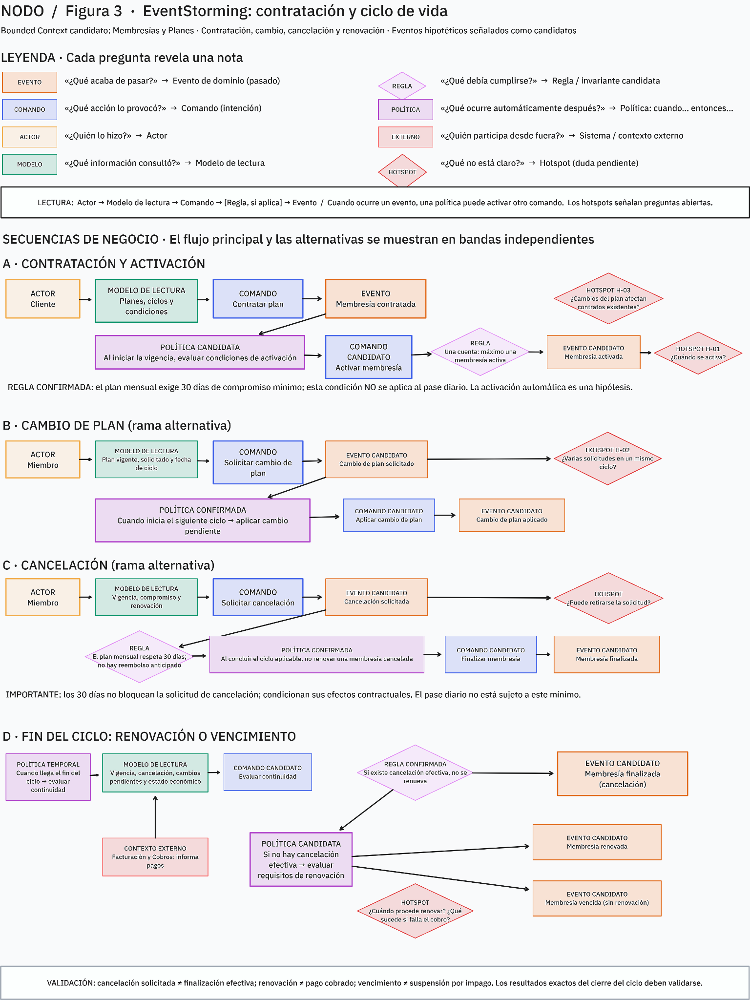
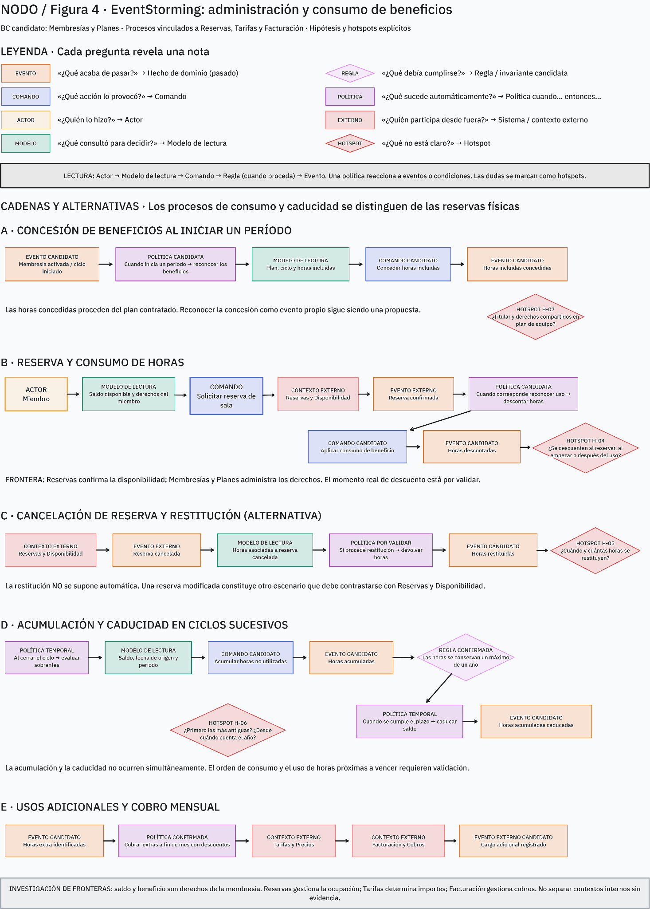
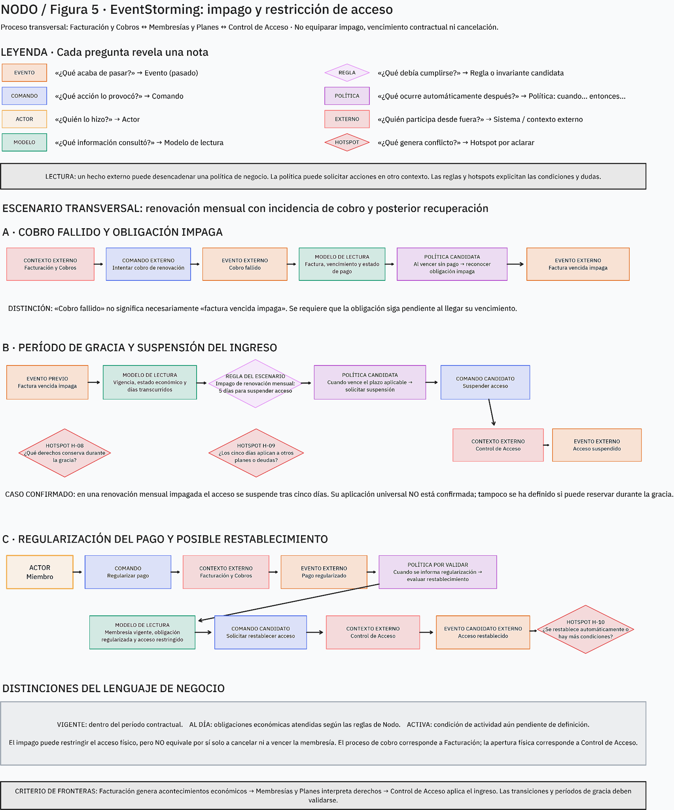

# 03 · EventStorming

Los tres procesos siguientes combinan hechos documentados con secuencias de modelado propuestas. Los eventos se expresan en pasado; cuando su existencia, momento o efecto no está confirmado se marcan como **candidatos**. La gramática del análisis distingue actores, comandos, eventos, reglas, políticas, modelos de lectura, contextos/sistemas externos y hotspots.

## Convención de lectura

- **Actor / comando:** persona o capacidad que inicia una acción, expresada en infinitivo.
- **Evento:** hecho ocurrido, expresado en pasado.
- **Modelo de lectura:** datos necesarios para tomar una decisión.
- **Regla:** condición de negocio; **política:** reacción desencadenada por un hecho o condición.
- **Externo:** capacidad con responsabilidad propia fuera de este BC.
- **Hotspot:** pregunta sin respuesta confirmada; no se resuelve por suposición.

## 1. Contratación y ciclo de vida

**Actores:** cliente/miembro; personal de Nodo (asignación concreta de recepción u operaciones por validar). **Externo:** Facturación y Cobros para hechos económicos relevantes.

| Camino | Actor/comando | Evento (candidato salvo indicación) | Lectura / regla |
|---|---|---|---|
| Principal | Cliente consulta modalidades y condiciones; selecciona y `Contratar plan` | `Membresía contratada` | Catálogo, condiciones y estado actual del cliente. No pueden coexistir dos membresías activas para una cuenta, sujeto a H-07. |
| Activación | `Activar membresía` | `Membresía activada` | Condición exacta de activación pendiente (**H-01**). |
| Cambio A | Miembro `Solicitar cambio de plan` | `Cambio de plan solicitado` | No altera condiciones efectivas durante el ciclo vigente. |
| Cambio B | Gestión aplica cambio al iniciar el ciclo siguiente | `Cambio de plan aplicado` | Regla documentada: entra en vigor en el siguiente ciclo; solicitudes múltiples pendientes (**H-02**). |
| Cancelación | Miembro `Solicitar cancelación`; finalizar al término aplicable | `Cancelación solicitada`; después `Membresía finalizada` | Solicitud no equivale a fin inmediato; respetar compromiso y condiciones contratadas. |
| Renovación | `Renovar membresía` | `Membresía renovada` | Continuidad según renovación, cambios y cancelación. |
| Vencimiento alternativo | Reconocer fin de ciclo sin renovar | `Membresía vencida` | No se inicia un nuevo período de vigencia. |

Los caminos A/B y renovación/vencimiento son alternativas, no una única secuencia que toda membresía atraviesa. Casos límite: segunda contratación, cambio durante ciclo, múltiples cambios, cancelación dentro de los 30 días, fin de ciclo y modificación del plan ofertado (**H-01–H-03**). El plan mensual se describe con compromiso mínimo de 30 días; no se extiende al pase diario.

**Políticas:** POL-01 registra el cambio para su siguiente ciclo; POL-02 evita continuidad de renovación según contrato; POL-03 evalúa renovación, cambio o finalización al cerrar el ciclo. **Lecturas:** plan ofertado, condiciones contratadas, membresía/actividad, fechas del ciclo y solicitudes pendientes. Véanse [RN/POL](06-reglas-invariantes.md).

## 2. Administración y consumo de beneficios

**Actores:** miembro. **Capacidades externas:** Reservas y Disponibilidad (reserva/ocupación), Tarifas y Precios (importe), Facturación y Cobros (cargo).

| Paso | Comando / responsable | Evento (candidato salvo indicación) | Regla / hotspot |
|---|---|---|---|
| 1 | `Reconocer beneficios del período` / Membresías y Planes | `Horas incluidas concedidas` | Cantidad depende del plan aplicable. |
| 2 | `Solicitar reserva de sala` / miembro; `Confirmar reserva` / Reservas | `Reserva confirmada` (externo) | Disponibilidad y confirmación pertenecen a Reservas. |
| 3 | `Aplicar consumo correspondiente` / Membresías y Planes | `Horas descontadas` | Momento de descuento por confirmar: al confirmar, comenzar o completar (**H-04**). |
| 4A | `Reconocer horas no utilizadas al cerrar período` | `Horas acumuladas` | Conservación máxima de un año. |
| 4B | `Reconocer uso superior al beneficio` | `Horas extra identificadas` | Consumo adicional sujeto a condiciones comerciales; fuente indica cobro al fin de mes. |
| 5 | `Aplicar caducidad al alcanzar límite temporal` | `Horas acumuladas caducadas` | No conservar más de un año; fecha y orden de consumo requieren validación (**H-06**). |
| Alternativa | Reservas `Cancelar reserva` | `Reserva cancelada` (externo) | Restitución de horas y tratamiento de cancelación tardía abiertos (**H-05**). |

**Lecturas:** plan/condiciones contratadas, membresía, período de origen y fechas de caducidad, saldo, reserva, descuentos y reglas tarifarias. **Políticas:** POL-04 evalúa actualización de saldo ante hecho de reserva (candidata); POL-05 retira horas caducadas; POL-08 identifica exceso para valoración/facturación. Alternativas: uso de horas actuales o acumuladas, cancelación tras compromiso, saldo próximo a caducar, exceso de beneficio y posible bolsa compartida de equipo (**H-04–H-07, H-12**).

Una reserva confirmada no equivale automáticamente a horas consumidas; horas reservadas y utilizadas son conceptos separados. Tampoco se define ahora consistencia técnica, concurrencia o mecanismo de coordinación.

## 3. Impago y consecuencias sobre el acceso

**Actores:** miembro. **Capacidades externas:** Facturación y Cobros reconoce obligaciones, pagos y regularizaciones; Membresías y Planes interpreta consecuencias contractuales; Control de Acceso administra ingreso físico.

| Paso | Comando / responsable | Evento (candidato salvo indicación) | Regla / hotspot |
|---|---|---|---|
| 1 | Facturación `Intentar cobro` | `Cobro fallido` | Hecho económico externo. |
| 2 | `Reconocer vencimiento de obligación impaga` | `Factura vencida impaga` | Deuda pendiente no equivale a fin de membresía. |
| 3 | Membresías `Evaluar condiciones de suspensión` | `Condición de suspensión alcanzada` | Plazos y gracia por precisar (**H-08, H-09**). |
| 4 | Control de Acceso `Suspender ingreso físico` | `Acceso suspendido` | Caso: renovación mensual; suspensión automática tras cinco días. No extrapolar a todas las modalidades. |
| 5 | Facturación `Regularizar obligación` | `Pago regularizado` | Facturación reconoce pago. |
| 6 | Control de Acceso `Restablecer ingreso cuando corresponda` | `Acceso restablecido` | Recuperación y automatismo pendientes (**H-10**). |

**Lecturas:** obligación y estado de pago, condiciones contratadas, vigencia, período de gracia, derecho de uso y autorización física. **Políticas:** POL-06 coordina consecuencias cuando se cumple la condición de suspensión (alcance limitado); POL-07 evalúa recuperación tras regularización (candidata). Alternativa central: impago con membresía todavía dentro de su vigencia o durante gracia.

El caso de cinco días se limita a la renovación mensual descrita. No se equiparan vigencia contractual, situación económica, actividad y permiso de ingreso. Véanse [DS-03](04-domain-stories.md#ds-03-impago-y-acceso-fisico), [H-08–H-10](08-hotspots-riesgos.md) y [Context Map](05-context-map.md).

## Modelos de lectura y límites del descubrimiento

| Proceso | Lecturas necesarias |
|---|---|
| Ciclo de vida | Modalidades y condiciones ofertadas; condiciones contratadas; cuenta/miembro y membresías vigentes; ciclo, cambio y cancelación pendientes. |
| Beneficios | Beneficios del plan; saldo separado por período; reservas relevantes; consumo reconocido; fechas de caducidad; descuento/precio/cargo diferenciados. |
| Impago/acceso | Estado de obligación externa; vigencia y condiciones; derechos durante gracia; condición de suspensión; autorización operativa externa. |

Las secuencias y nombres no confirmados son candidatos de modelado. La evidencia primaria no está disponible en este repositorio; sus límites y la procedencia registrada se explican en [09-trazabilidad.md](09-trazabilidad.md). No se definen contratos, eventos de integración ni patrones de Sesión 4.
