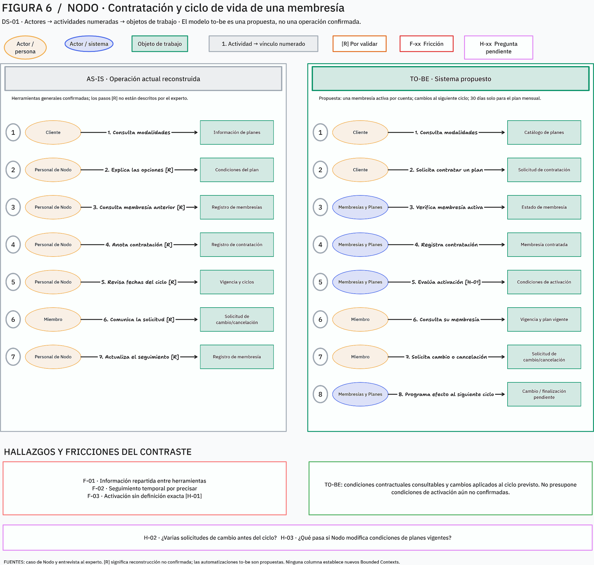
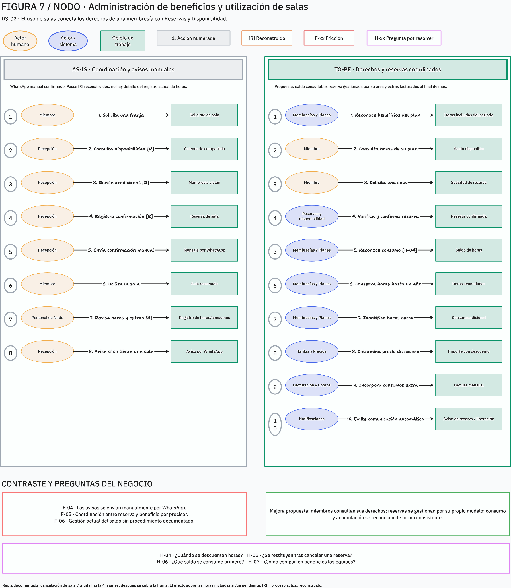
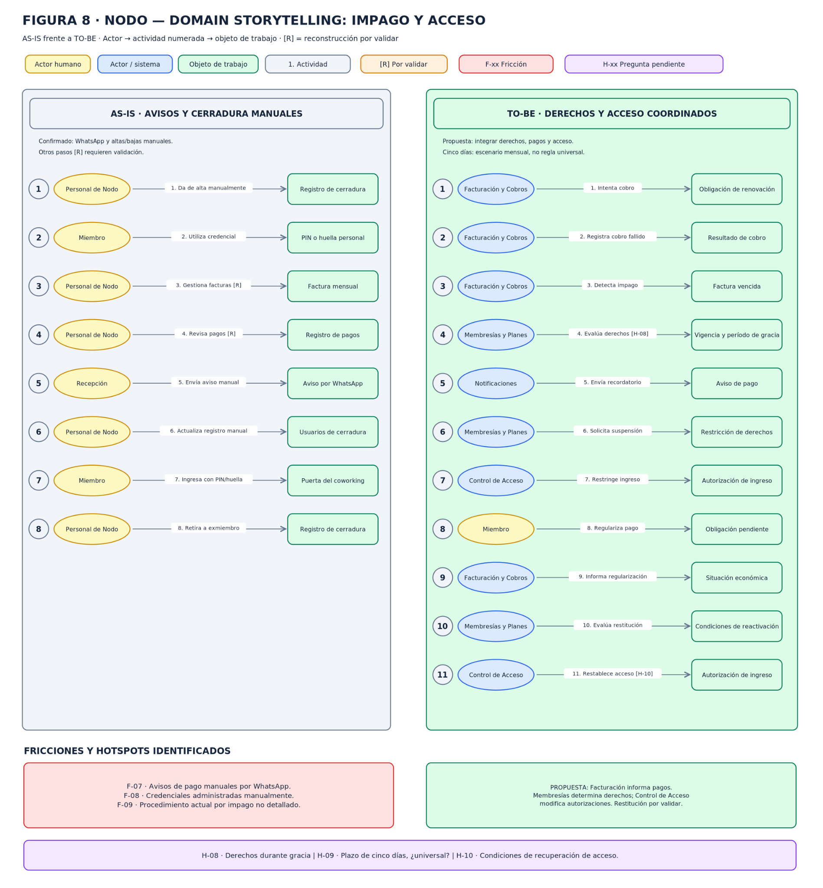

# 04 · Domain Stories

Las historias enlazan actores, actividades y objetos de trabajo con los tres procesos de [EventStorming](03-eventstorming.md). **As-is** resume evidencias del caso y reconstrucciones explícitamente no confirmadas; **to-be** describe una propuesta funcional, no un requisito aprobado.

## DS-01 · Contratación y ciclo de vida

**Actores:** cliente, personal de recepción/operaciones; en to-be, sistema Membresías y Planes. **Objetos:** catálogo, condiciones, registro de membresía, período, solicitud de cambio/cancelación.

### As-is

| Actor | Actividad | Objeto |
|---|---|---|
| Cliente | Consulta modalidades y condiciones. | Información de planes |
| Personal de Nodo | Explica duración, condiciones y beneficios. | Plan y condiciones |
| Personal de Nodo | Consulta la información disponible del cliente y posible membresía previa. | Registro de membresías |
| Personal de Nodo | Registra la contratación y sus condiciones; revisa vigencia y continuidad. | Membresía y período |
| Cliente | Comunica cambio o cancelación cuando corresponde. | Solicitud |

**Evidencia:** herramientas actuales incluyen hojas de cálculo, calendario compartido y grupos de WhatsApp. La secuencia administrativa detallada (consulta de registros/actualización) es reconstrucción a validar, no un procedimiento confirmado paso a paso.

### To-be

| Actor | Actividad propuesta | Objeto |
|---|---|---|
| Cliente | Consulta planes y solicita contratación. | Catálogo y solicitud |
| Membresías y Planes | Comprueba membresías activas, registra contratación con condiciones aplicables y evalúa la activación. | Estado y condiciones |
| Miembro | Consulta vigencia y condiciones; solicita cambio o cancelación. | Membresía y solicitudes |
| Membresías y Planes | Aplica cambio o finalización cuando corresponda al ciclo. | Ciclo de contratación |

**Reglas y excepciones:** no dos membresías activas simultáneas; compromiso de 30 días para mensual, no pase diario; cambio efectivo siguiente ciclo; solicitud de cancelación no implica fin inmediato ni reembolso anticipado. Resolver H-01–H-03 antes de automatizar activación, cambios múltiples o modificaciones del catálogo.

**Fricciones y mejora:** **F-01** información distribuida → consulta coherente; **F-02** seguimiento de ciclos/fechas → evaluar cambios, renovaciones y cancelaciones conforme a reglas; **F-03** activación ambigua → definir condición antes de automatizar. Correspondencia: `Membresía contratada` → `Membresía activada` (candidato) → solicitud/aplicación de cambio; alternativamente cancelación/finalización o renovación/vencimiento.

## DS-02 · Utilización de salas y beneficios

**Actores:** miembro, recepción/operaciones; en to-be, Reservas y Disponibilidad, Membresías y Planes, Tarifas y Precios, Facturación y Cobros. **Objetos:** membresía, plan, calendario, solicitud/reserva, bolsa/saldo y consumo.

### As-is

1. Miembro solicita una sala para una franja.
2. Personal consulta calendario/disponibilidad y condiciones de membresía, y gestiona la confirmación.
3. Recepción comunica confirmación por WhatsApp.
4. Miembro utiliza la sala.
5. Personal identifica qué uso afecta beneficios o es adicional, y puede avisar manualmente sobre liberación de sala.

La entrevista resumida en el documento confirma que la sala se confirma si hay disponibilidad y el plan está al día; los avisos son manuales y las horas extra se cobran al final del mes. El procedimiento real de descuento, acumulación y restitución no está descrito.

### To-be

1. Membresías y Planes reconoce beneficios y saldo aplicable al período.
2. Miembro consulta derechos y solicita sala.
3. Reservas comprueba disponibilidad y decide confirmación.
4. Membresías reconoce consumo con una regla por definir; identifica exceso.
5. Tarifas determina importe y Facturación registra el cargo que corresponda.
6. Membresías acumula o declara caducadas horas según condiciones temporales.

El sistema no debe inferir que reservar equivale a consumir. La comunicación puede usar Notificaciones como capacidad transversal; no se asigna a esta la decisión de dominio.

**Fricciones y mejora:** **F-04** avisos manuales → comunicación basada en acontecimientos; **F-05** coordinación incompletamente documentada → responsabilidades explícitas entre reserva y derechos; **F-06** seguimiento de saldos poco documentado → consulta de disponibles, usados, acumulados y caducados.

**Casos límite:** cancelación tres horas antes, después del plazo gratuito; fuente documenta gratuidad hasta cuatro horas antes y cargo posterior por franja completa, pero H-05 deja sin resolver restitución. Horas acumuladas próximas a caducar y consumo simultáneo (**H-04–H-06, H-12**). Correspondencia: horas incluidas concedidas → reserva confirmada (externo) → horas descontadas (candidato) → acumuladas/extra → caducadas.

## DS-03 · Impago y acceso físico

**Actores:** miembro, personal de Nodo/recepción, responsable de cobros; en to-be, Facturación y Cobros, Membresías y Planes, Control de Acceso y Notificaciones. **Objetos:** factura, pago, membresía, aviso, registro/credencial de cerradura y autorización.

### As-is

1. Personal de cobros gestiona cuota mensual y consumos adicionales; miembro paga mediante medios aceptados.
2. Personal identifica facturas pendientes/vencidas y recepción envía aviso por WhatsApp.
3. Personal registra individualmente PIN/huella en la cerradura y retira manualmente a quien deja de ser miembro.
4. Miembro utiliza su credencial para ingresar.

La fuente confirma registro y retiro manual de usuarios de cerradura, avisos manuales e impago con posibles consecuencias de suspensión. No confirma el procedimiento que conecta deuda y modificación de la cerradura.

### To-be

1. Facturación intenta el cobro, reconoce resultado y obligación vencida cuando corresponde.
2. Membresías evalúa efectos contractuales considerando condiciones y gracia.
3. Notificaciones puede comunicar el aviso pertinente.
4. Control de Acceso aplica restricción cuando se cumplan las condiciones.
5. Tras regularización, Facturación reconoce el pago y se evalúa si procede restablecer derechos y autorización.

La suspensión tras cinco días se limita al caso de renovación mensual descrito. La restauración no está confirmada y el acceso físico sigue siendo responsabilidad de Control de Acceso.

**Fricciones y mejora:** **F-07** avisos dependientes del personal → comunicaciones a partir de acontecimientos; **F-08** gestión manual de credenciales → coordinar condiciones con Control de Acceso; **F-09** vínculo pago/acceso no descrito → precisar suspensión y recuperación antes de automatizar.

**Correspondencia:** `Cobro fallido` → `Factura vencida impaga` → `Acceso suspendido` (si corresponde) → `Pago regularizado` → `Acceso restablecido` (candidato). Véanse H-01, H-08–H-10.

## Escenarios alternativos y excepciones

| Historia | Caso límite | Regla documentada y pregunta abierta |
|---|---|---|
| DS-01 | Cliente intenta contratar con otra membresía activa. | No coexistencia confirmada; definir comunicación y posible alternativa de cambio. |
| DS-01 | Cancelación antes de completar el compromiso mensual. | 30 días para plan mensual, no pase diario; la solicitud no implica reembolso ni fin inmediato. ¿Puede retirarse antes de su efecto? |
| DS-02 | Reserva cancelada tres horas antes del inicio. | La gratuidad termina cuatro horas antes y la franja tardía se cobra completa; H-05 deja abierto si se restituyen horas. |
| DS-02 | Horas acumuladas de distintos períodos próximas a caducar. | Acumulación máxima de un año; H-06 deja abiertos orden y fecha de caducidad. |
| DS-03 | Renovación mensual impaga durante período de gracia. | Cinco días se describen solo para ese escenario; H-08–H-10 preguntan derechos, alcance y recuperación. |
| DS-01/DS-02 | Plan de equipo con varios usuarios. | Existe la modalidad, pero titularidad, membresía y distribución de derechos no están confirmadas (H-07). |
| DS-01 | Se modifica un plan con contratos vigentes. | No se sabe si contratos existentes conservan condiciones o reciben nuevas; H-03. |

También se deja abierta la concurrencia de varias reservas sobre las últimas horas de una membresía (H-12). Ninguno de estos casos autoriza inferir respuestas ausentes.

## Registro de fricciones

| Código | As-is observado o reconstruido | Mejora propuesta; no decisión aprobada |
|---|---|---|
| F-01 | Información contractual distribuida en herramientas. | Consultar datos coherentes de membresías/beneficios. |
| F-02 | Seguimiento manual de renovaciones, cambios y cancelaciones por comprobar. | Evaluar reglas temporales explícitas. |
| F-03 | Activación no definida con precisión. | Aclarar antes de automatizar. |
| F-04 | Avisos de reserva manuales por WhatsApp. | Comunicaciones originadas en acontecimientos. |
| F-05 | Coordinación reserva/derechos no documentada suficientemente. | Definir responsabilidad de cada modelo. |
| F-06 | Mecanismo de saldo no descrito. | Consultar horas disponibles, usadas, acumuladas y caducadas. |
| F-07 | Avisos de pago manuales. | Comunicar acontecimientos económicos pertinentes. |
| F-08 | Altas/bajas individuales de cerradura manuales. | Coordinar condiciones con Control de Acceso. |
| F-09 | Enlace pago y acceso poco descrito. | Definir consecuencias, gracia, suspensión y recuperación. |

Las reconstrucciones as-is y propuestas to-be deben actualizarse cuando se disponga de evidencia primaria o respuestas adicionales. Los casos alternativos se contrastan con [EventStorming](03-eventstorming.md) y [hotspots](08-hotspots-riesgos.md).
