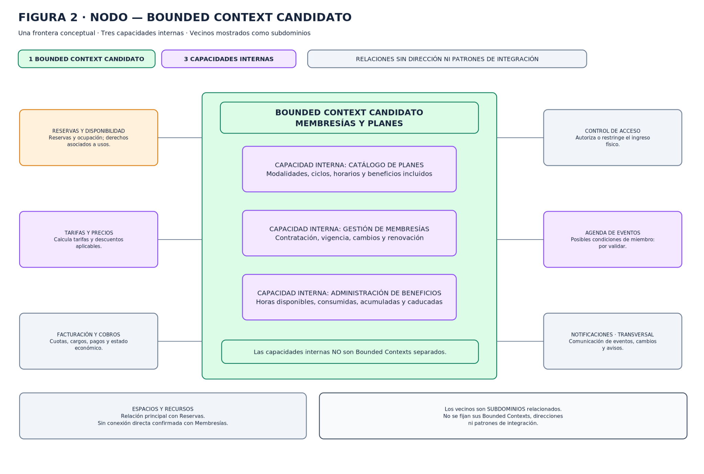

# 07 · Bounded Context candidato

La propuesta estratégica mantiene un único BC propio llamado **Membresías y Planes**. Es una decisión provisional basada en señales de descubrimiento; no se adopta por la mera coincidencia de nombre entre subdominio y BC.

## Frontera y lenguaje propio

Dentro del BC se reúnen tres capacidades, sin subfronteras de BC:

1. **Catálogo de Planes:** oferta, modalidades y condiciones generales.
2. **Gestión de Membresías:** contratación particular, condiciones contratadas, vigencia, renovación, cambio, cancelación y finalización.
3. **Administración de Beneficios:** derechos de uso adquiridos, horas incluidas/utilizadas/acumuladas/caducadas y consumo adicional.

El vocabulario enlaza `Plan ofertado` con `condiciones contratadas`, y estas con `beneficio disponible`. La información no se equipara a decisión externa: reserva/ocupación es de Reservas, facturas/pagos de Facturación, precio final de Tarifas y autorización/ingreso físico de Control de Acceso. Ver [glosario](02-glosario.md).

## Señales evaluadas

| Señal | Evidencia de Nodo | Resultado para la frontera |
|---|---|---|
| Polisemia | `Plan`, `Membresía` y `Beneficio disponible` difieren internamente; mayor contraste con `Reserva`, `Factura` y `Autorización física`. | Aporta fronteras externas; no demuestra por sí sola modelos internos incompatibles. |
| Independencia de reglas | Cada capacidad tiene reglas propias, pero las condiciones contratadas conectan oferta, ciclo de vida y derechos. | Diferenciación funcional sin independencia suficiente para separar ahora. |
| Actores y responsabilidades | Se mencionan recepción, operaciones y dirección, sin responsables autónomos establecidos para cada capacidad interna. | Evidencia organizativa insuficiente para partición interna. |
| EventStorming | Contratación, beneficios e impago se encadenan y comparten conceptos; reservas, cobros y acceso cruzan responsabilidades. | Refuerza cohesión interna y fronteras externas. |
| Domain Storytelling | Las capacidades aparecen relacionadas en procesos; los cambios claros de responsabilidad ocurren ante reserva, cobro y acceso físico. | Respalda provisionalmente un único BC. |

## Alternativas consideradas

| Alternativa | A favor | En contra / evidencia faltante | Decisión |
|---|---|---|---|
| **Uno:** Membresías y Planes con tres capacidades | Mantiene reglas relacionadas de oferta, contratación y beneficios; evita traducciones internas sin evidencia. | Revisar si una capacidad demuestra autonomía real. | **Propuesta principal provisional.** |
| **Dos:** Catálogo de Planes y Gestión de Membresías | Diferencia oferta comercial de contratación particular. | No se demostró independencia de lenguaje, actores, reglas o evolución; H-03 podría aportar evidencia. | Alternativa abierta, no adoptada. |
| **Tres:** Catálogo, Membresías y Beneficios | Aísla administración de saldo/derechos. | Añade fronteras a procesos estrechamente relacionados sin evidencia de modelo autónomo. | No adoptada actualmente. |

No se divide solo porque existan procesos o agrupaciones funcionales. La decisión se revisará si H-03, H-06, H-07 u otros casos muestran vocabularios incompatibles, reglas que evolucionan de forma independiente o responsabilidades diferenciadas.

## Fronteras externas y criterios de revisión

Las fronteras más claras corresponden a ocupación de recursos (**Reservas**), obligaciones económicas (**Facturación**), autorización de ingreso (**Control de Acceso**) e importes (**Tarifas**). Eventos y Espacios y Recursos son candidatos con relación directa no demostrada. Notificaciones es transversal.

Casos de revisión: modificar plan con membresías vigentes; plan de equipo con derechos compartidos; consumo/cancelación de reservas; saldos acumulados; deuda durante gracia. No se resuelven sus preguntas en esta propuesta. Véanse [Context Map](05-context-map.md) y [hotspots](08-hotspots-riesgos.md).

## Estado

La decisión es estratégica hasta Sesión 3. Los vecinos siguen siendo candidatos para validación por sus equipos; no se fijan patrones de integración ni diseño táctico. La evidencia primaria no está disponible en este repositorio; véase el ADR [0001](../decisiones/0001-delimitacion-unico-bounded-context.md).
